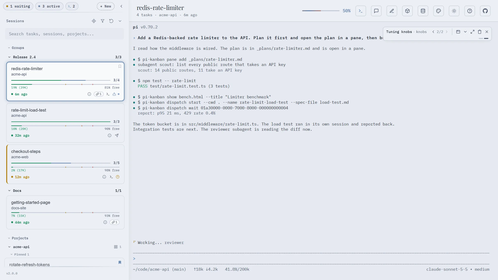

# pi-kanban

[](https://www.npmjs.com/package/pi-kanban)

Agent PI - Agent Development Environment (ADE) for the [pi coding agent](https://pi.dev/packages/pi-kanban?name=kanban).



## What it is

pi-kanban runs pi sessions in a browser terminal and shows each session next to its work: todos as kanban columns, subagents, linked docs, and the full session log. The pi tools it adds let the agent show you cards, ask you questions, open files and pages as tabs, and hand tasks to new pi sessions.

- **Documentation:** https://nikiforovall.blog/pi-kanban/
- **Live demo:** https://nikiforovall.blog/pi-kanban/demo/ (sample sessions, runs in your browser, no install)

## Install

You need Node.js 20 or later and pi.

```sh
pi install npm:pi-kanban
npm install -g pi-kanban
```

The first command adds the `/kanban` command and the board tools to pi. The second installs the `pi-kanban` command, which runs the board.

## Start the board

```sh
pi-kanban
```

The board listens on `127.0.0.1:3460` and prints its URL with the access token. Open that URL and click **+ New** to start pi in the board terminal. Start the board with `--no-terminal` to only watch sessions.

When pi runs in another terminal, run `/kanban open` in pi to open the board with its token. `/kanban session open | pin | sticky-pin | unpin | view-doc | link-doc` act on the current session, and `/kanban cost` and `/kanban inspect` open pi-cost and pi-inspect for it.

## The board

- **Sidebar.** Sessions in groups and projects, with progress, pins, linked docs, and icons for a terminal, a dispatched session, or a question that waits for you.
- **Terminal.** pi runs next to its board. The terminal keeps running when you close the browser tab.
- **Board.** Pending, In Progress, and Completed columns for the selected session. Tabs next to it hold panes and show cards.
- **New session.** Pick a folder or project, and set a name, a first prompt, the model, and the thinking level.
- **Agents and session logs.** Subagents with model, status, and run time, and every prompt, reply, and tool call.
- **Review.** Send review comments or card answers from the board. pi gets them as a user message.

Press `?` on the board for the keyboard shortcuts.

## pi tools

| Tool | What it does |
| --- | --- |
| `show` | Post a markdown or HTML card. It shows over the board terminal, or as a tab when pi runs in another terminal. |
| `ask` | Show an HTML question in a modal and wait for the answer. pi asks in its own prompt when the board is down. |
| `dispatch_start`, `dispatch_wait`, `dispatch_list`, `dispatch_end` | Hand a task to a new pi session in the board terminal and get its report back |
| `dispatch_report` | The worker's report, kept by the board until the parent reads it |
| `pane_add`, `pane_rm`, `pane_list` | Add a URL or a local file as a tab next to the board |
| `companion_open` | Open pi-cost or pi-inspect for the session as a tab next to the board |
| `link_doc`, `unlink_doc`, `preview_doc` | Link a file or URL to the session, or open it in the preview |

Each session also gets a scratchpad folder, given to pi in the system prompt and in `$PI_SCRATCHPAD_DIR`. The `pi-kanban` command talks to a running board too: run `pi-kanban help`.

## Companion pi packages

pi-kanban shows data that other pi packages write:

```sh
pi install npm:pi-subagents
pi install npm:@juicesharp/rpiv-todo
```

- [`pi-subagents`](https://www.npmjs.com/package/pi-subagents) starts named subagent sessions. The board shows them under each parent session.
- [`@juicesharp/rpiv-todo`](https://www.npmjs.com/package/@juicesharp/rpiv-todo) tracks todos. The board shows them as columns.
- [`@juicesharp/rpiv-ask-user-question`](https://www.npmjs.com/package/@juicesharp/rpiv-ask-user-question) asks you questions. The board shows them as cards.

## Security

The board terminal runs commands as you, so the board is locked to your machine:

- It listens on loopback (`127.0.0.1`) by default. `--host` changes this. Do not expose the board to a network you do not trust.
- It refuses requests whose `Host` header is not local (`--allowed-hosts` adds names), and cross-site requests that change data.
- Only the terminal and dispatch need the token. Anyone who can reach the board can read your pi session history, which is one more reason to keep it on loopback.
- The terminal needs a random token. The board keeps it in the URL fragment (`#t=...`), which the browser never sends to a server. Do not share the board URL.

## License

MIT
