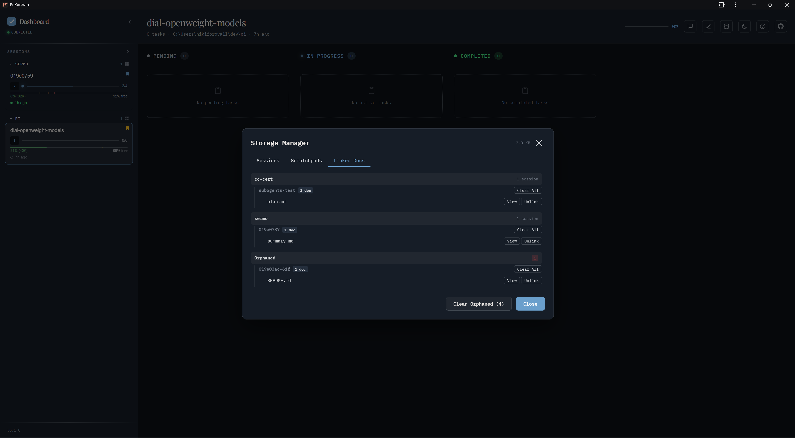
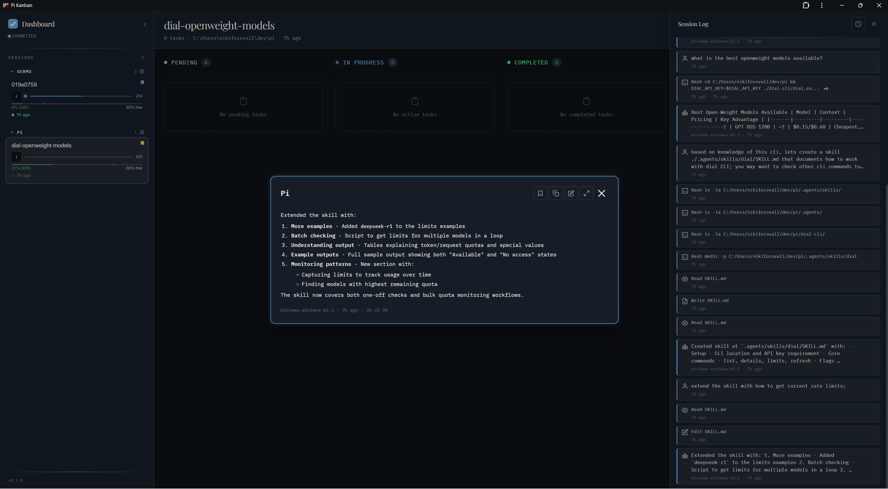

import Shot from '../../../kit/Shot.astro';
import Lightbox from '../../../kit/Lightbox.astro';

A walkthrough of the dashboard and `/kanban` commands. For installation, see [Getting started](../../getting-started/). For plugging your own planning flow or themes in, see [Extensibility](../extensibility/).

## Slash commands

Run from inside pi:

### Global commands

| Command | What it does |
| ---------------------- | ---------------------------------------------------- |
| `/kanban start` | Start the local server (port 3460) in the background |
| `/kanban stop` | Stop the running server |
| `/kanban restart` | Restart the server (picks up theme/config changes) |
| `/kanban status` | Show whether the server is running |
| `/kanban open web` | Open the dashboard in the default browser |
| `/kanban open app` | Open in a standalone PWA window (if installed) |

### Session commands

All session commands default to the current session when `[<id>]` is omitted.

| Command | What it does |
| --------------------------------------- | ---------------------------------------------------- |
| `/kanban session open [<id>]` | Open/focus a session in the dashboard |
| `/kanban session pin [<id>]` | Pin a session |
| `/kanban session sticky-pin [<id>]` | Sticky-pin a session |
| `/kanban session unpin [<id>]` | Remove a pin |
| `/kanban session view-doc <path> [<id>]` | Render a markdown file in the dashboard preview pane |
| `/kanban session link-doc <path> [<id>]` | Add a document link to a session |

## Layout

<Shot themed="board" alt="The board with the session sidebar, todo columns, agents log, and session log" eager />

- **Left sidebar** — session list grouped by project. Each row shows progress, age, pin state.
- **Center** — kanban board (Pending / In Progress / Completed) for the selected session, populated from `@juicesharp/rpiv-todo`.
- **Right** — Session Log: all messages, tool calls, subagent activity. Auto-scrolls; click a message to expand.
- **Bottom strip** — recent subagent runs across sessions.

## Sessions and projects

pi-kanban reads `~/.pi/agent/sessions/<encoded-cwd>/<timestamp>_<id>.jsonl` and groups sessions by their working directory.

## Subagents

When `pi-subagents` spawns a child session, pi-kanban nests it under its parent and renders the agent's lifecycle (start, tool use, completion) inline.

<Shot themed="subagent" alt="A planner subagent with its prompt and response" />

## Session info

Click the info icon on any session for full metadata: model, token usage, cache hit rate, cost, duration, paths.

<Shot themed="session-info" alt="Session info modal with session id, project, path, and branch" />

## Storage manager

The Storage Manager (toolbar icon) lists sessions, scratchpads, and linked docs with size accounting. Use it to clean orphaned docs or unlink stale references.

## Follow last message

Pop out the latest assistant message in a floating window — useful for monitoring long-running runs while you work elsewhere.

## Light mode

The dark/light toggle switches between the two themes configured in settings. See [Theming](../../reference/theming/). The screenshots on this site follow the mode you pick at the top of the page.

## Keyboard shortcuts

Press `?` in the dashboard for the full list. Common ones:

- `J` / `K` — next / previous todo in a column
- `H` / `L` — move to the left / right column
- `Tab` — switch focus between the sidebar and the board
- `Shift+L` — toggle the session log
- `I` — open session info
- `T` — toggle dark/light
- `Esc` — close a panel or cancel

<Shot themed="shortcuts" alt="Keyboard shortcuts help with global, navigation, and action keys" />

<Lightbox />
